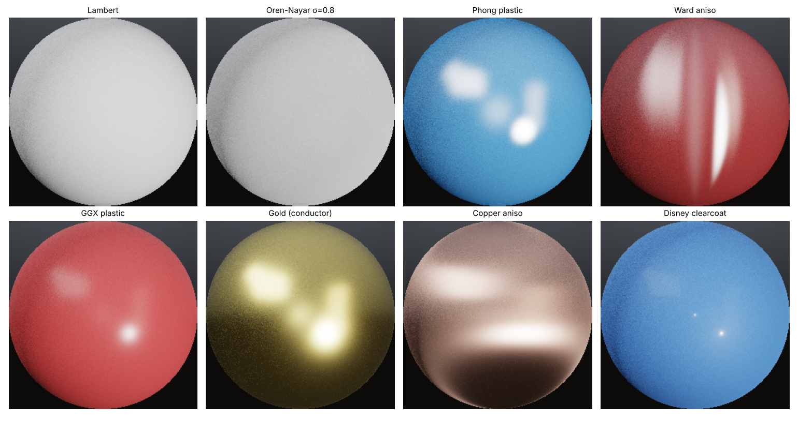
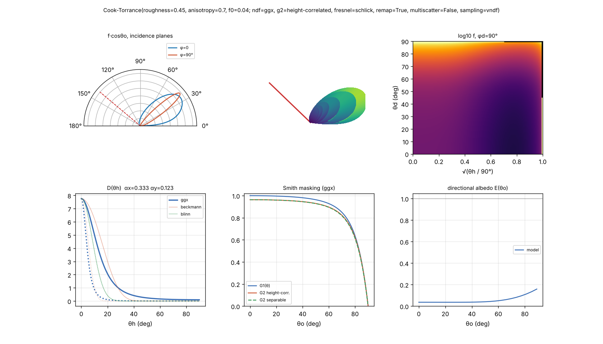
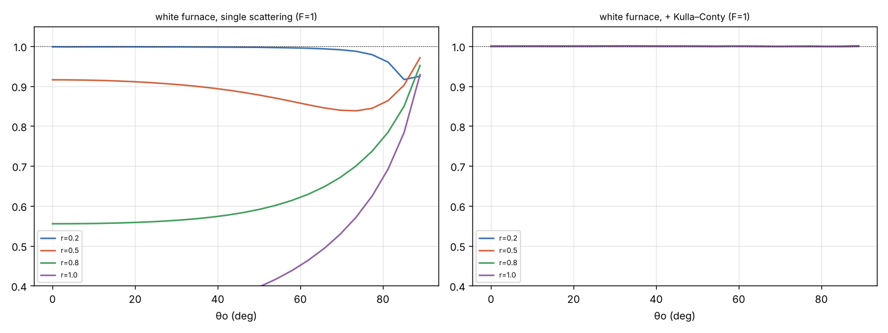
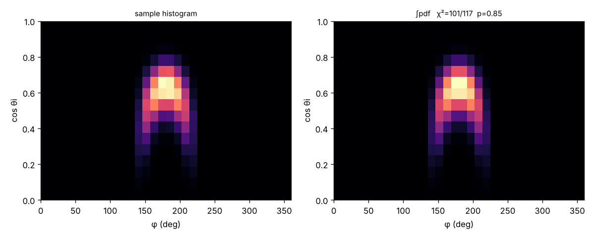
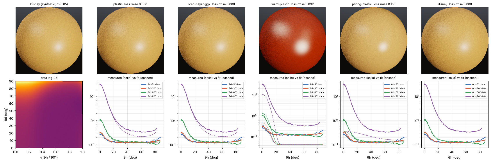
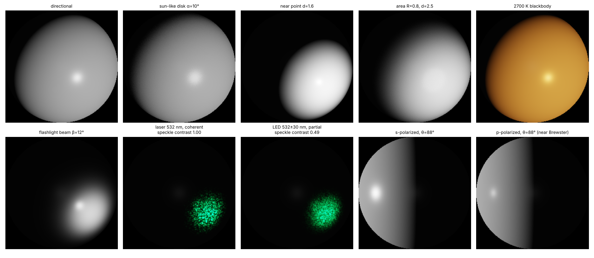
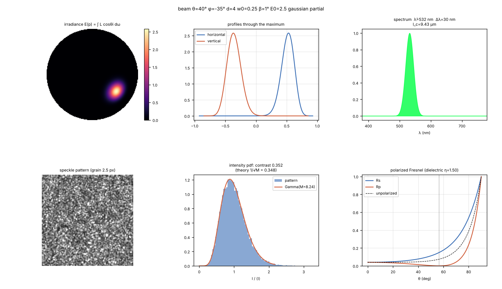
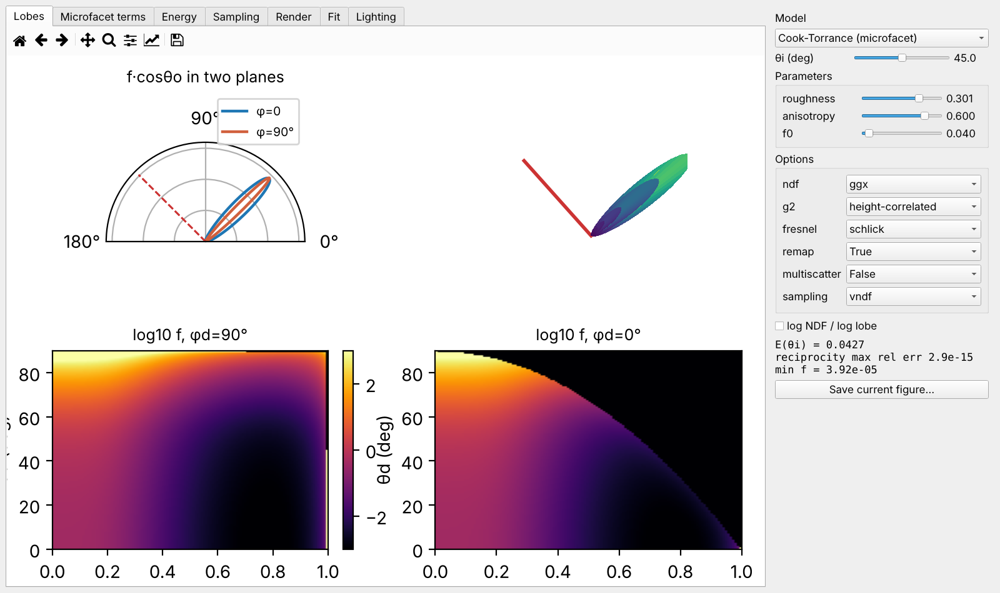
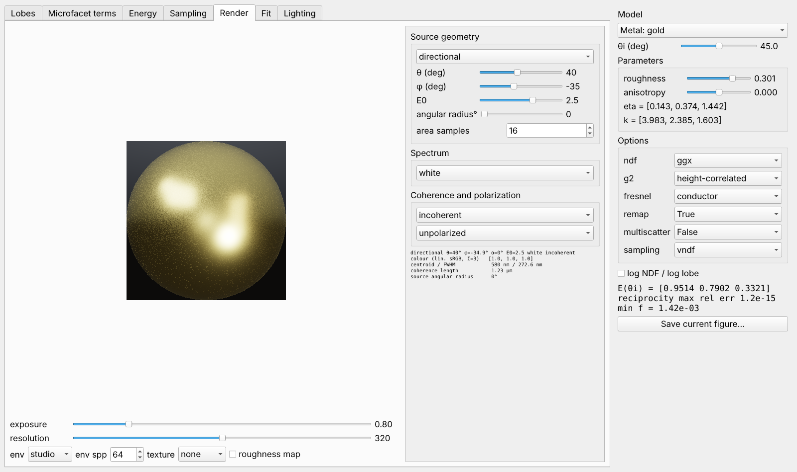

# BRDF Toolbox



I originally wrote this as a single rushed script: a GGX/Beckmann/Blinn microfacet explorer with a
polar lobe plot and a shaded sphere. This version turns it into a proper package. It covers the
standard analytic BRDFs, checks each one for the physical properties it should have (energy
conservation, reciprocity, a sampler that actually matches its pdf), fits them to measured MERL data,
and renders them on a sphere under configurable light sources, including near-field, area, beam,
spectral, partially coherent and polarized illumination.

Everything is NumPy/SciPy and vectorized. On one core it does about 6 M Cook–Torrance and 3 M Disney
evaluations per second. Directions live in the local frame (n = +z, t = +x) as (..., 3) arrays, and
parameters broadcast elementwise, so RGB parameters (shape (3,)) and spatially varying parameter maps
need no special code.

## Install and run

```bash
git clone https://github.com/gaschenb/BRDF.git
cd BRDF
pip install -r requirements.txt
pip install -e .
brdf-toolbox-gui                 # or: python -m brdftoolbox.gui
brdf-toolbox --help              # or: python -m brdftoolbox
pytest brdftoolbox/tests         # 74 tests, about 20 s
python -m brdftoolbox.examples.gallery docs/figures
```

You need Python 3.10+ with numpy, scipy and matplotlib. The GUI also needs PyQt5.

## Features

1. Analytic models: Lambert, Oren–Nayar [8], energy-normalized Phong [9], Blinn–Phong [10],
   anisotropic Ward [11, 12], Cook–Torrance [1, 2] and the Disney principled BRDF [7].
2. Composite materials (diffuse + specular sums) and conductor presets for gold, silver, copper and
   aluminium [29, 30].
3. Measured BRDFs: reading and writing MERL tables [13], trilinear lookup in Rusinkiewicz half/difference
   coordinates [14], and tabulating any analytic model into MERL format.
4. Importance sampling for every model, including GGX visible-normal sampling [4, 5].
5. Physical checks: directional and hemispherical albedo, white-furnace tests, reciprocity, NDF
   normalization, a χ² test of each sampler against its pdf [19], and estimator variance comparisons.
6. Kulla–Conty multiple-scattering compensation [6].
7. Fitting of analytic models to measured data, with per-channel parameters [15, 16].
8. A sphere renderer with point lights and an importance-sampled studio environment.
9. Light sources with distance, spread, beam divergence, spectrum, coherence (speckle) and
   polarization [21, 22, 23].
10. A PyQt5 GUI with seven tabs and a CLI with seven subcommands.

## Methods

### Microfacet model

Cook–Torrance is f = D F G2 / (4 |n·ωi| |n·ωo|) [1, 2].

1. The normal distribution D is GGX (Trowbridge–Reitz) [28, 2], Beckmann [27] or Blinn [10]. All three
   are anisotropic, using αx and αy from roughness and anisotropy with the Burley remap α = r² [7].
2. Masking-shadowing uses the exact Smith Λ for each distribution [26, 3]. The Beckmann Λ uses erf
   rather than the usual rational approximation. G2 is either height-correlated or separable [3].
3. Fresnel is Schlick [17], exact dielectric [18], exact conductor with complex IOR [18, 19], or off.
   Exact Fresnel is split into Rs and Rp so polarized light works.
4. Single scattering loses energy at high roughness. The Kulla–Conty term [6] adds it back from tabulated
   E(μ, α) and E_avg(α), computed with VNDF quasi-Monte Carlo, with the Fresnel-coloured factor
   F_avg² E_avg / (1 − F_avg (1 − E_avg)). Anisotropic roughness is treated as isotropic here, using
   √(αxαy).



### Other models

1. Oren–Nayar uses the qualitative A/B form [8].
2. Phong uses the Lafortune–Willems energy normalization (n+2)/(2π) [9]. Blinn–Phong uses
   (n+8)/(8π) [10].
3. Ward uses the Geisler-Moroder–Dür normalization [12], which is reciprocal and keeps albedo bounded,
   unlike the original [11]. It has a 1/cos²θd factor that grows at grazing angles.
4. Disney follows Burley 2012 [7]: retro-reflective diffuse, a subsurface approximation, sheen, an
   anisotropic GGX specular and a GTR1 clearcoat. I use height-correlated Smith G for the base layer
   instead of the 2012 roughness remap.

### Sampling

1. GGX visible normals are sampled with the spherical-caps method [5], which matches the
   density of Heitz's method [4].
2. Anisotropic GGX and Beckmann can also sample the NDF directly, using the elliptical azimuth warp from
   Walter et al. and Ward [2, 11].
3. Phong uses a cosine-power lobe around the mirror direction. Disney picks between cosine, VNDF and
   GTR1 lobes with weights from their estimated albedos. Composites mix their components'
   samplers, and the Kulla–Conty lobe adds a cosine branch with probability 1 − E(μo).
4. Albedos are estimated with scrambled Sobol points [24] and BRDF importance sampling, or with
   Gauss–Legendre quadrature for smooth lobes.
5. Each sampler is checked with a Pearson χ² test between a (cos θ, φ) histogram of its samples and the
   integral of its pdf over the same bins, as in pbrt [19].

### Measured data and fitting

1. MERL files are 90 × 90 × 180 tables over (θh, θd, φd) with the non-linear θh index
   90√(θh/(π/2)) and the per-channel scales from the original release [13]. The angles are Rusinkiewicz
   half/difference coordinates [14].
2. Lookup is trilinear in index space, with φd wrapped modulo π by reciprocity.
3. Fitting is bounded multi-start `least_squares` on log(1 + f cosθi cosθo) residuals. This follows the
   log-space, cosine-weighted losses used by Ngan et al. and Löw et al. [15, 16]. Colour parameters (albedo,
   F0, ks) get one value per channel, and lobe parameters are shared across channels. Parameters can be
   tied (for example αy = αx for isotropic Ward).
4. MERL data is isotropic (φh = 0), so it can't fully determine anisotropic parameters. With Ward
   fitted to a MERL table, only ks/αy is identifiable. For anisotropic fits, use direction samples instead.

### Lighting

The sphere has unit radius at the origin. `intensity` is the normal irradiance delivered at the sphere
centre, so distance and spread change the shape of the illumination but not its overall level.

1. Directional lights can have an angular radius, which makes them disk sources like the sun. A point light at
   finite distance gives a per-point incidence direction and 1/r² falloff. Giving it a radius makes it a
   spherical area emitter, sampled uniformly over the subtended cone and clipped at the horizon, which
   gives soft highlights and a penumbra.
2. Beams are Gaussian with waist w0 and half-angle divergence β, so w(z)² = w0² + (z tan β)² [23].
   Rays leave from the virtual apex w0/tan β behind the source, and on-axis irradiance scales as
   (w_c/w)².
3. Spectra are white, blackbody (Planck) or Gaussian (λ0 with FWHM Δλ). I convert them to linear sRGB
   with the Wyman–Sloan–Shirley fit of the CIE 1931 matching functions [21]. The coherence length is
   l_c = λ²/Δλ.
4. Speckle uses Goodman's statistics [22]. Fully coherent light gives exponential intensity
   statistics with contrast 1. Partially coherent light sums M independent patterns, giving
   Gamma(M, 1/M) intensity and contrast 1/√M, where M = M_λ · M_Ω · M_pol:
   1. M_λ = √(1 + (4π σh / l_c)²) comes from the source bandwidth against the surface height spread σh.
   2. M_Ω = 1 + (α_s/α_c)², with α_c = λ/(2πσh), comes from the angular size α_s of the source.
   3. M_pol = 2 for a depolarizing surface.

   M_λ and M_Ω are approximations; the exact factors depend on the spectral and height
   distributions [22]. Speckle images are circular-Gaussian fields filtered by a circular pupil, so the
   grain size is set in pixels. Non-integer M is handled exactly with a weighted sum of patterns.
5. Polarization is set as a linear E-field angle. 0 lies in the plane spanned by the light and view
   directions, which is p at the highlight, and 90 is perpendicular to it (s). The per-pixel
   s-fraction (ê·ŝ)² weights Rs and Rp in exact Fresnel, which reproduces Brewster's angle [18]. Schlick-based
   models (Disney, and Cook–Torrance with Schlick Fresnel) ignore polarization.
6. Interference between several coherent sources isn't modelled. The fringe periods are far below a
   pixel.

### Rendering

1. The camera is orthographic. Each pixel's tangent frame follows the sphere's longitude, so anisotropy
   shows up as stretched highlights.
2. Duff et al.'s orthonormal basis [20] is used for sampling frames.
3. The environment is integrated with BRDF importance sampling, using Sobol points with a per-pixel
   Cranley–Patterson rotation [24].
4. Tone mapping uses Narkowicz's ACES fit [25] followed by the sRGB transfer curve.

## Results and examples

All figures are produced by `python -m brdftoolbox.examples.gallery docs/figures`, and the numbers are
written to `brdf_output/results.json`.

1. With F = 1 the single-scattering GGX albedo (minimum over θo) falls to 0.92 at roughness 0.2, 0.84 at
   0.5, 0.56 at 0.8 and 0.31 at 1. With the Kulla–Conty term it stays within 0.12% of 1 at all four
   roughnesses [6].

   

2. Every model is reciprocal to within 4e-15 and non-negative. Every sampler passes the χ² test (p from
   0.04 to 0.92). Importance sampling cuts the variance of the albedo estimate by 276× for GGX plastic,
   262× for Phong plastic, 1270× for anisotropic Ward and 1589× for gold, relative to uniform
   hemisphere sampling.

   

3. The checks found two models that exceed albedo 1. Disney reaches 1.04 at grazing angles, which is
   a known property of its diffuse term [7]. A plain Lambert + GGX sum reaches 1.025, because the
   diffuse term isn't reduced by the specular Fresnel.
4. I fitted five models to synthetic Disney data with 5% log-normal noise (base colour 0.7/0.35/0.1,
   roughness 0.4, specular 0.6, sheen 0.5). Disney recovers its own parameters to about 1e-3
   (log-RMSE 0.008). Lambert + GGX is just as good (0.008), and Oren–Nayar + GGX matches it. Ward
   (0.092) and Phong (0.150) fit badly: Ward's grazing 1/cos²θd factor and Phong's mirror-centred lobe
   don't match the data's shape [15]. Fitting each model to its own tabulation recovers the parameters
   exactly, so the fitting code isn't the problem.

   

5. Lighting: disk, near-field point, area, blackbody, flashlight beam, coherent laser speckle (contrast
   1.00), partially coherent LED speckle (contrast 0.49), and s versus p polarization near Brewster's
   angle, where the p highlight is more than 5× dimmer.

   

   

## GUI

```bash
brdf-toolbox-gui [--merl file.binary]
```

The right panel has the model selector, a θi slider, a slider for every parameter (log-scaled for
exponents) and a menu for every option. Only the visible tab recomputes. You can zoom in on any plot,
but zooming out and panning stop at the full data extent.

1. **Lobes**: f·cosθo in two planes, a 3D lobe, and half/diff slices at φd = 90° and 0°.
2. **Microfacet terms**: NDFs, Fresnel (including the metals), Smith G1/G2 and the Kulla–Conty E(θ) table.
3. **Energy**: albedo curves compared with the Kulla–Conty version and the F = 1 furnace, plus the full check
   report.
4. **Sampling**: the sample histogram against ∫pdf with the χ² p-value, and the estimator variance for
   uniform, cosine and BRDF sampling.
5. **Render**: the sphere with the light panel (geometry, spread, distance, spectrum, coherence,
   polarization, with tooltips explaining each setting physically), a live readout of l_c, M and the
   predicted speckle contrast, the studio or uniform environment, textures and a roughness map.
6. **Fit**: load a MERL file or use the current model as data (optionally with noise), fit several models in
   a background thread, then compare renders and slices.
7. **Lighting**: the irradiance map and profiles, the spectrum, the speckle pattern and its intensity
   pdf against Gamma(M), and Rs/Rp with the Brewster angle.





## CLI

`--set k=v` sets a parameter or option. A comma list sets an RGB parameter, and composite models use
`name.k`. `--light` takes either `θ,φ,E` or `k=v,...` with the fields of `Light`.

```bash
brdf-toolbox list
brdf-toolbox plot     --model cook-torrance --set roughness=0.4 --set anisotropy=0.6 --theta 50
brdf-toolbox check    --model disney --set clearcoat=1 --out out/
brdf-toolbox check    --model cook-torrance --set fresnel=none --set multiscatter=true --set roughness=1
brdf-toolbox sample   --model ward --set alpha_x=0.1 --set alpha_y=0.4 --theta 60 --out out/
brdf-toolbox render   --model metal --set name=copper --set roughness=0.25 --env studio --spp 128
brdf-toolbox render   --model plastic --texture checker --roughness-map
brdf-toolbox render   --model plastic --light kind=point,distance=1.8,radius=0.4,spectrum=blackbody,temperature=3000
brdf-toolbox render   --model plastic --light kind=beam,distance=5,waist=0.1,divergence=3,spectrum=gaussian,wavelength=532,bandwidth=0.01,coherence=partial,roughness_um=5
brdf-toolbox light    --light kind=point,radius=0.5,coherence=partial,roughness_um=2 --out light.png
brdf-toolbox fit      --merl gold-metallic-paint.binary --fit plastic,oren-nayar-ggx,disney --out fit/
brdf-toolbox fit      --synthetic disney --set base_color=0.7,0.3,0.1 --noise 0.05 --fit all
brdf-toolbox tabulate --model ward --out ward.binary
```

1. `list` prints every model with its parameters, bounds and options, plus the fit presets.
2. `plot` writes the overview figure and a Fresnel plot.
3. `check` prints the energy, reciprocity, χ² and efficiency report, and can save JSON and an albedo plot.
4. `sample` runs the sampler χ² test and the variance comparison.
5. `render` renders the sphere with any number of `--light` sources.
6. `light` prints the derived light quantities and writes the lighting analytics figure.
7. `fit` fits one or more presets to a MERL file or to synthetic data.
8. `tabulate` writes any model as a MERL `.binary` file.

## Library use

```python
import numpy as np
import brdftoolbox as bt
from brdftoolbox.core import lights as LT
from brdftoolbox.core.analytics import format_report
from brdftoolbox.core.frames import sph_dir

m = bt.CookTorrance(roughness=0.4, anisotropy=0.5, fresnel="dielectric", eta=1.5, multiscatter=True)
f = m.eval(sph_dir(0.6, np.pi), sph_dir(0.6, 0.0))              # BRDF value
wi, pdf = m.sample(np.broadcast_to(sph_dir(0.6, 0.0), (1000, 3)), np.random.rand(1000, 3))
E, err = bt.directional_albedo(m, np.deg2rad([0, 45, 80]))      # albedo with stderr
print(format_report(bt.report(m)))                              # energy, reciprocity, χ², efficiency

gold = bt.metal("gold", roughness=0.3)                          # RGB complex IOR
img = bt.render_sphere(gold, res=256, env="studio", spp=64,
                       lights=[LT.Light(kind="point", distance=2.0, radius=0.3, spectrum="blackbody",
                                        temperature=3200)])

data = bt.Measured.from_file("gold-metallic-paint.binary")      # or bt.Measured.from_model(model)
res = bt.fit_preset("plastic", data, n_samples=20000, n_starts=4)
print(res.summary())
```

## Layout

1. `brdftoolbox/core/frames.py`: directions, orthonormal bases, half/difference coordinates, hemisphere
   samplers.
2. `brdftoolbox/core/fresnel.py`: Schlick, dielectric and conductor Fresnel (with s/p), metal IORs, averages.
3. `brdftoolbox/core/microfacet.py`: NDFs, Smith Λ/G1/G2, VNDF and NDF sampling, GTR1.
4. `brdftoolbox/core/multiscatter.py`: Kulla–Conty tables and the multiple-scattering lobe.
5. `brdftoolbox/core/models.py`: the BRDF base class, all analytic models, composites and presets.
6. `brdftoolbox/core/measured.py`: MERL I/O, lookup and tabulation.
7. `brdftoolbox/core/analytics.py`: albedo, energy, reciprocity, NDF checks, χ² and efficiency.
8. `brdftoolbox/core/fitting.py`: multi-start least-squares fitting and fit presets.
9. `brdftoolbox/core/lights.py`: light sources, spectra, coherence and speckle, polarization.
10. `brdftoolbox/core/render.py`: sphere geometry, environments, tone mapping, renderer, irradiance maps.
11. `brdftoolbox/core/plots.py`: every matplotlib view used by the GUI, CLI and gallery.
12. `brdftoolbox/cli.py`: the command-line interface.
13. `brdftoolbox/gui/app.py`: the PyQt5 GUI.
14. `brdftoolbox/examples/gallery.py`: generates the figures in `docs/figures`.
15. `brdftoolbox/tests/`: 74 tests covering the core, lighting and GUI (offscreen).
16. `docs/figures/`: the figures in this README.

## Citations

1. R. L. Cook and K. E. Torrance, "A reflectance model for computer graphics," *ACM Transactions on
   Graphics*, 1(1), 7–24, 1982.
2. B. Walter, S. R. Marschner, H. Li and K. E. Torrance, "Microfacet models for refraction through
   rough surfaces," *Eurographics Symposium on Rendering*, 2007.
3. E. Heitz, "Understanding the masking-shadowing function in microfacet-based BRDFs," *Journal of
   Computer Graphics Techniques*, 3(2), 2014.
4. E. Heitz, "Sampling the GGX distribution of visible normals," *Journal of Computer Graphics
   Techniques*, 7(4), 2018.
5. J. Dupuy and A. Benyoub, "Sampling visible GGX normals with spherical caps," *Computer Graphics
   Forum*, 42(8), 2023.
6. C. Kulla and A. Conty, "Revisiting physically based shading at Imageworks," SIGGRAPH Course:
   Physically Based Shading in Theory and Practice, 2017.
7. B. Burley, "Physically-based shading at Disney," SIGGRAPH Course: Practical Physically Based
   Shading in Film and Game Production, 2012.
8. M. Oren and S. K. Nayar, "Generalization of Lambert's reflectance model," *SIGGRAPH*, 1994.
9. E. P. Lafortune and Y. D. Willems, "Using the modified Phong reflectance model for physically
   based rendering," Technical Report CW197, KU Leuven, 1994.
10. J. F. Blinn, "Models of light reflection for computer synthesized pictures," *SIGGRAPH*, 1977.
11. G. J. Ward, "Measuring and modeling anisotropic reflection," *SIGGRAPH*, 1992.
12. D. Geisler-Moroder and A. Dür, "A new Ward BRDF model with bounded albedo," *Computer Graphics
    Forum*, 29(4), 2010.
13. W. Matusik, H. Pfister, M. Brand and L. McMillan, "A data-driven reflectance model," *ACM
    Transactions on Graphics*, 22(3), 2003.
14. S. Rusinkiewicz, "A new change of variables for efficient BRDF representation," *Eurographics
    Workshop on Rendering*, 1998.
15. A. Ngan, F. Durand and W. Matusik, "Experimental analysis of BRDF models," *Eurographics
    Symposium on Rendering*, 2005.
16. J. Löw, J. Kronander, A. Ynnerman and J. Unger, "BRDF models for accurate and efficient rendering
    of glossy surfaces," *ACM Transactions on Graphics*, 31(1), 2012.
17. C. Schlick, "An inexpensive BRDF model for physically-based rendering," *Computer Graphics Forum*,
    13(3), 1994.
18. M. Born and E. Wolf, *Principles of Optics*, 7th ed., Cambridge University Press, 1999.
19. M. Pharr, W. Jakob and G. Humphreys, *Physically Based Rendering: From Theory to Implementation*,
    4th ed., MIT Press, 2023.
20. T. Duff, J. Burgess, P. Christensen, C. Hery, A. Kensler, M. Liani and R. Villemin, "Building an
    orthonormal basis, revisited," *Journal of Computer Graphics Techniques*, 6(1), 2017.
21. C. Wyman, P.-P. Sloan and P. Shirley, "Simple analytic approximations to the CIE XYZ color
    matching functions," *Journal of Computer Graphics Techniques*, 2(2), 2013.
22. J. W. Goodman, *Speckle Phenomena in Optics: Theory and Applications*, Roberts & Company, 2007.
23. A. E. Siegman, *Lasers*, University Science Books, 1986.
24. I. M. Sobol', "On the distribution of points in a cube and the approximate evaluation of
    integrals," *USSR Computational Mathematics and Mathematical Physics*, 7(4), 86–112, 1967.
25. K. Narkowicz, "ACES filmic tone mapping curve," blog post, 2016.
26. B. G. Smith, "Geometrical shadowing of a random rough surface," *IEEE Transactions on Antennas
    and Propagation*, 15(5), 668–671, 1967.
27. P. Beckmann and A. Spizzichino, *The Scattering of Electromagnetic Waves from Rough Surfaces*,
    Pergamon Press, 1963.
28. T. S. Trowbridge and K. P. Reitz, "Average irregularity representation of a rough surface for ray
    reflection," *Journal of the Optical Society of America*, 65(5), 531–536, 1975.
29. P. B. Johnson and R. W. Christy, "Optical constants of the noble metals," *Physical Review B*,
    6(12), 4370–4379, 1972.
30. A. D. Rakić, "Algorithm for the determination of intrinsic optical constants of metal films:
    application to aluminum," *Applied Optics*, 34(22), 4755–4767, 1995.
